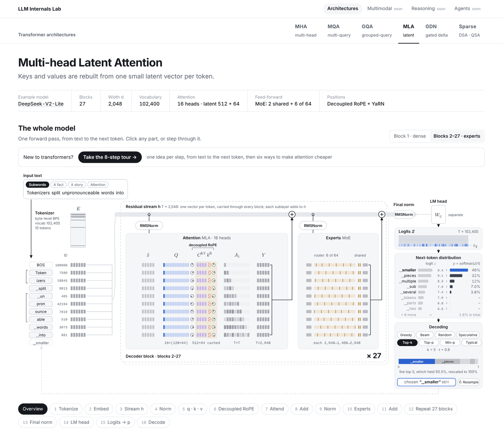

# LLM Internals Lab

An interactive, offline explorer of how language models work, each idea shown in a real model with its
published dimensions: six attention mechanisms, from text to the next token, and four ways of feeding
images to a language model. Plus readable PyTorch implementations, tested against Hugging Face
`transformers`.

**Live app:** <https://valentinsvelev.github.io/llm-internals-lab/>



**Architectures**

| Tab | Mechanism | Model |
|---|---|---|
| MHA | multi-head attention | GPT-2 small |
| MQA | multi-query attention | Gemma 2B |
| GQA | grouped-query attention | Qwen2.5-0.5B |
| MLA | multi-head latent attention | DeepSeek-V2-Lite |
| GDN | Gated DeltaNet + gated attention | Qwen3-Next-80B-A3B |
| Sparse | DeepSeek Sparse Attention (and Qwen's QSA) | DeepSeek-V3.2 |

**Multimodal** (try your own image; it never leaves the browser)

| Tab | How the image reaches the language model | Model |
|---|---|---|
| Projector | 336 × 336 crop → 576 tokens through an MLP | LLaVA-1.5-7B |
| Native size | one token per 32 × 32 pixels, 3D positions (M-RoPE), DeepStack | Qwen3-VL-8B |
| Cross-attention | up to 4 tiles, read by 8 gated cross-attention layers | Llama 3.2 11B Vision |
| Pooling | 896 × 896 → 4,096 patches → averaged to 256 tokens | Gemma 3 4B |

Retrieval, Reasoning and Agents pages are planned.

## Run the explorer

It is one self-contained HTML file: open `src/llm_lab/assets/explorer.html` in a browser.
Or serve it (no dependencies beyond Python):

```bash
pip install -e .
llm-lab --serve                  # http://127.0.0.1:8767
```

## PyTorch reference implementations

`llm_lab.reference` builds all six models from their configs (attention, MLA, YaRN, the lightning
indexer, Gated DeltaNet, mixture of experts, KV caches) and implements the eight decoding methods the
page shows; `llm_lab.reference.vision` has the four image pipelines (resizing, connectors, M-RoPE
positions, Gemma's image mask, gated cross-attention). How they are verified:
[docs/reference-implementations.md](docs/reference-implementations.md).

```bash
pip install -e ".[pytorch]"
python -m llm_lab.reference      # parameters, active parameters, cache per token
```

## Tests

```bash
pip install -e ".[dev]"
python -m playwright install chromium
python -m pytest
```

The page is built from [web/](web/README.md). `python -m llm_lab.next_token` replaces its
illustrative next-token logits with real ones.

## Deployment

Pushes to `main` run the tests and then publish the page to GitHub Pages
(`.github/workflows/deploy.yml`). Enable **Settings → Pages → Source: GitHub Actions** once.

## License

MIT. The page bundles Temml (MIT) and a subset of Latin Modern Math (GUST Font License);
see [docs/attribution.md](docs/attribution.md).
